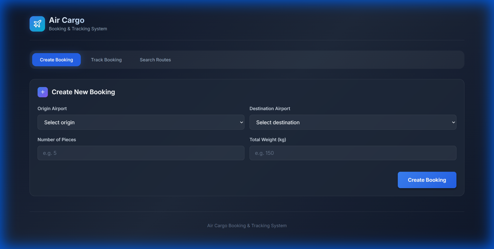
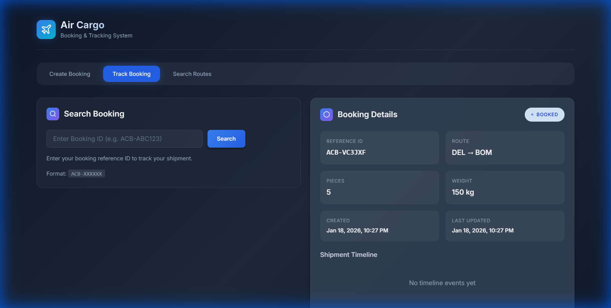
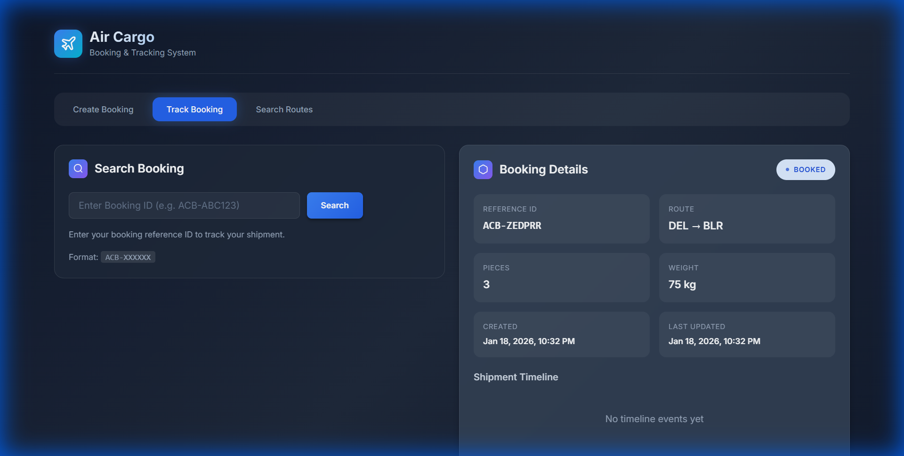
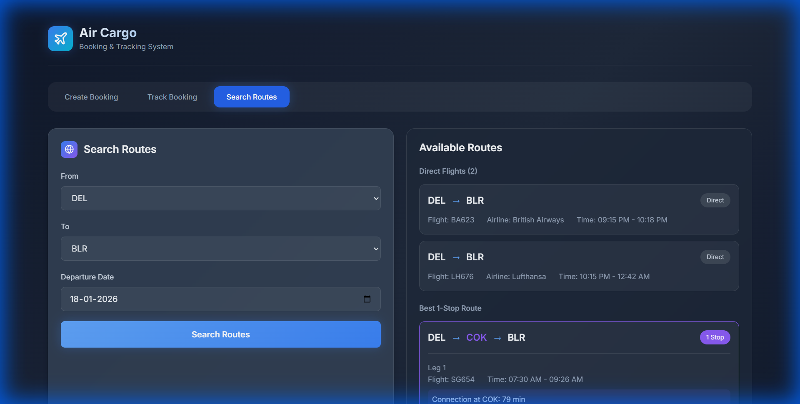

# Air Cargo Booking & Tracking System

A production-ready air cargo booking and tracking system with full-stack implementation.

## Quick Start

### Prerequisites
- Node.js 18+ 
- npm

### Backend Setup

```bash
cd backend
npm install
npm run migrate   # Create database schema
npm run seed      # Seed ~100K flight records
npm run dev       # Start server on port 3001
```

### Frontend Setup

```bash
cd frontend
npm install
npm run dev       # Start dev server on port 5173
```

Open http://localhost:5173 in your browser.

---

## Project Structure

```
├── backend/
│   ├── src/
│   │   ├── controllers/     # API route handlers
│   │   ├── services/        # Business logic
│   │   ├── repositories/    # Database access
│   │   ├── models/          # State machine
│   │   ├── middleware/      # Logging, errors
│   │   └── utils/           # Helpers
│   ├── migrations/          # SQL schema
│   ├── tests/               # Unit tests
│   └── seed/                # Data seeding
│
└── frontend/
    └── src/
        ├── components/      # React components
        └── services/        # API client
```

---

## API Endpoints

| Method | Endpoint | Description |
|--------|----------|-------------|
| GET | `/api/routes` | Search flight routes |
| GET | `/api/routes/airports` | List airports |
| POST | `/api/bookings` | Create booking |
| GET | `/api/bookings/:refId` | Get booking + timeline |
| GET | `/api/bookings` | List bookings |
| POST | `/api/bookings/:refId/depart` | Mark departed |
| POST | `/api/bookings/:refId/arrive` | Mark arrived |
| POST | `/api/bookings/:refId/deliver` | Mark delivered |
| POST | `/api/bookings/:refId/cancel` | Cancel booking |

---

## Running Tests

```bash
cd backend
npm test
```

---

## Key Features

- **Booking Management**: Create, track, and manage cargo bookings
- **Route Search**: Find direct and 1-transit routes
- **Timeline Tracking**: Immutable event history
- **State Machine**: Enforced booking status transitions
- **Concurrency Control**: Optimistic locking for safe updates
- **Caching**: LRU cache for route queries (5 min TTL)
- **Monitoring**: Health endpoint with metrics
- **Modern UI**: Dark theme with glassmorphism design

---

## 🎥 Demo


### Screenshots

<table>
  <tr>
    <td></td>
    <td></td>
  </tr>
  <tr>
    <td align="center"><b>Create Booking Form</b></td>
    <td align="center"><b>Booking Details & Timeline</b></td>
  </tr>
  <tr>
    <td></td>
    <td></td>
  </tr>
  <tr>
    <td align="center"><b>Track Booking</b></td>
    <td align="center"><b>Route Search Results</b></td>
  </tr>
</table>

---

## Documentation

- [High-Level Design (HLD)](./docs/HLD.md)
- [Low-Level Design (LLD)](./docs/LLD.md)
- [Walkthrough with Screenshots](./docs/WALKTHROUGH.md)

---

## Deployment

### Prerequisites
1. Push to GitHub
2. Sign up for [Vercel](https://vercel.com) (frontend) and [Railway](https://railway.app) or [Render](https://render.com) (backend)

### Backend Deployment (Railway/Render)

1. Create a new project and connect your GitHub repo
2. Set the root directory to `backend`
3. Set environment variables:
   - `PORT` (usually auto-set)
   - `NODE_ENV=production`
   - `CORS_ORIGIN=https://your-frontend.vercel.app`
4. Deploy and note your backend URL

### Frontend Deployment (Vercel)

1. Import your GitHub repository
2. Vercel will auto-detect the `vercel.json` configuration
3. Set environment variable:
   - `VITE_API_URL=https://your-backend-url.railway.app`
4. Deploy!

### Environment Variables Summary

| Variable | Location | Description |
|----------|----------|-------------|
| `VITE_API_URL` | Frontend | Backend API URL |
| `PORT` | Backend | Server port |
| `NODE_ENV` | Backend | Environment mode |
| `CORS_ORIGIN` | Backend | Allowed frontend origin |


---

## Sponsor

If you find this helpful, consider supporting me:

- **Support:** [GitHub Sponsors](https://github.com/sponsors/minianon) · [Buy me a chai](https://buymeachai.ezee.li/minianon)

---

## License

This project is licensed under the MIT License - see the [LICENSE](LICENSE) file for details.

---

## Contact

- **Connect:** [link.minianon.in/tusharbhardwaj](https://link.minianon.in/tusharbhardwaj)
- **Tushar Bhardwaj** - [Portfolio](https://minianon.in/)
- **Connect 1:1** - [Topmate](https://topmate.io/tusharbhardwaj)
- **GitHub:** [minianon](https://github.com/minianon)
- **LinkedIn:** [Tushar Bhardwaj](https://www.linkedin.com/in/bhardwajtushar2004/)
- **Email:** [tusharbhardwaj2617@gmail.com](mailto:tusharbhardwaj2617@gmail.com)

